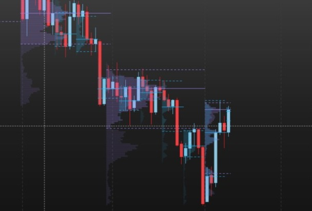

# Volume Profile M/W/D/H for MotiveWave

**English** | [Русский](README.ru.md)

[](LICENSE)


Volume profiles of the **month, week, CME day and hour** on a MotiveWave chart: volume by price, the **POC** and the **70 % value area (VAH / VAL)** of each period. The current period grows with every finished minute; past periods are drawn inside their own time span.

The calculation is the one of the author's research platform *Futures Tester*, row for row: on the same minutes both give the same rows, POC, VAH and VAL.



> **Display only.** The indicator is a plain MotiveWave *Study*. It has no access to the order API and **cannot place, modify or cancel orders**.

## What it draws

- **Four profiles in one indicator**: month (M), week (W), day (D) and hour (H). Each has its own switch, color, transparency, row height and number of past periods. Only the day profile is on by default.
- **Periods follow the CME clock** (America/New_York, so your own time zone and daylight saving never matter):
  - **day** = the Globex session, 18:00 the evening before – 17:00;
  - **week** = Monday's session to Friday's (opens Sunday 18:00);
  - **month** = by trade date (the evening of a month's last day already belongs to the next month);
  - **hour** = counted from the 18:00 open: 18:00, 19:00, … 16:00.
- **For each period:** a histogram from the period's first bar to the right (its longest row reaches *Profile width* % of the period), rows inside the value area brighter, the **POC solid**, **VAH and VAL dashed** across the period.
- **Under the candles and never in the way.** The profiles are drawn below the price bars and do not take mouse clicks, so your lines and other indicators on top stay selectable.
- **Shown where it makes sense** (can be switched off): the hour profile on charts up to 15-minute bars, the day up to 4 hours, the week up to daily bars, the month up to weekly bars.

## How it is calculated

- **From 1-minute bars that the indicator asks MotiveWave for itself**, so a month profile is complete whatever the chart's own bars are (a 15-minute chart may have loaded only a few days).
- A minute's volume is spread **evenly over the price rows** its high–low range covers. This is an approximation: a tick profile would put each trade at its exact price; minutes are what a long history has.
- **Row height** is set in ticks (defaults: hour 4, day 8, week 20, month 40 — on MNQ that is 1, 2, 5 and 10 points; on MGC with its 0.10 tick, 0.4, 0.8, 2 and 4 dollars). Change it per profile for other products.
- **POC** = the row with the most volume (on a tie, the one nearer the middle of the range).
- **Value area** = grows from the POC two rows at a time towards the side whose next two rows hold more volume (the upper side on a tie) until it holds **70 %** of the period's volume — the usual Market Profile rule. VAH is the top of its upper row, VAL the bottom of its lower row, the POC line is the middle of its row.
- **Only finished minutes count.** A minute is taken 2 seconds after it ends; the last 20 minutes are asked again with every new minute, so a late correction by the platform replaces them.
- **Never a guessed profile:** a period whose start MotiveWave's history does not reach is left out instead of being drawn from a part of it.

## Settings

| Tab | Setting | Default |
|---|---|---|
| Profiles (one group per M / W / D / H) | Month / Week / Day / Hour profile (on/off) | only Day on |
| | Color | M violet, W blue, D orange, H green |
| | Transparency % | 70 |
| | Ticks per row | 40 / 20 / 8 / 4 |
| | Past periods (besides the current one) | 3 / 8 / 10 / 24 |
| Display | Profile width, % of the period | 60 |
| | Only on charts with shorter bars | on |
| | POC, VAH and VAL lines | on |

The gear icon in the chart legend opens a small panel with the four switches, the four colors and the width.

## Install

1. Download `VolumeProfile.jar` from the [latest release](../../releases/latest) (or build it, see below).
2. Put it into the **`MotiveWave Extensions`** folder in your home folder (on macOS `~/MotiveWave Extensions`). MotiveWave picks it up within seconds.
3. Add it from **Study → Alex Indicators → Volume Profile M/W/D/H**.

> The menu folder is called *Alex Indicators* (the author keeps all their MotiveWave indicators there). Rename it with the `MENU_GENERAL` line in `volume_profile/nls/strings.properties`.

> Tested on macOS with MotiveWave 7.1.3 and CME futures (MNQ, MGC). Only the public MotiveWave SDK is used, so platform updates that rename internal classes do not affect it.

## Good to know

- **Futures Tester and the week / month grid.** Futures Tester builds its rows on its back-adjusted continuous history, so its 5- and 10-point rows of the week and month sit a few ticks off round prices; here the rows follow the real prices of the contract on the chart. Day and hour profiles match exactly; week and month POC/VAH/VAL may differ by one row offset (2 points on MNQ).
- **One contract per chart.** On a chart of a single contract (e.g. MNQZ6) the profiles use that contract's own minutes; after a roll, open the new contract's chart.
- **Holidays.** A trading day is always 18:00–17:00. On a CME holiday with a shortened session the day profile follows that rule, not the exchange calendar.
- **Journal.** The indicator writes what it loaded and calculated to `~/Library/MotiveWave/VolumeProfile/audit-DATE.log` (macOS): the history it received, every finished profile with its POC/VAH/VAL, and the newest minute every 10 minutes — handy for checking a value.

## Build from source

Requirements: a JDK (17 or newer), `mwave_sdk.jar` and the JavaFX jars (`javafx.*.jar`) from your own MotiveWave installation — none of them is included here. On macOS `build.sh` finds all of it inside `/Applications/MotiveWave.app` by itself.

```bash
bash build.sh            # builds build/VolumeProfile.jar and runs the tests
bash build.sh install    # also copies it into ~/MotiveWave Extensions
```

Different locations: `MW_SDK=/path/to/mwave_sdk.jar MW_EXT=/path/to/extensions bash build.sh install`.

The calculation lives in `volume_profile/core` and has no MotiveWave dependency; the tests (`test/volume_profile/Tests.java`) cover the value-area rule, the CME periods, coverage of the history, past/current periods and that no minute after a moment is ever read.

You can check the "no orders" claim yourself: `javap -v` on the compiled classes shows no reference to `order_mgmt` or `OrderContext`.

## Changelog

- **0.1.2** — a longer history that the platform returns empty or short (e.g. right after the month profile is switched on) is asked for again, up to 5 times 30 s apart; the colors in the gear panel are named (Month color, Week color, ...).
- **0.1.1** — the current period follows the market within a minute (MotiveWave flags its newest 1-minute bars as not complete for ~15 minutes; a minute now counts once its time is over, and the last 20 minutes are asked again).
- **0.1.0** — first version: month, week, day and hour profiles, POC and 70 % value area, as in Futures Tester.
