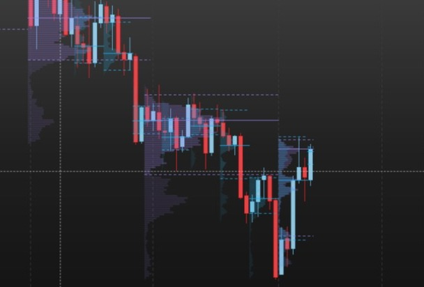

# Volume Profile M/W/D/H для MotiveWave

[English](README.md) | **Русский**

[](LICENSE)


Профили объёма **месяца, недели, торгового дня CME и часа** на графике MotiveWave: объём по ценам, **POC** и **зона стоимости 70 % (VAH / VAL)** каждого периода. Профиль текущего периода растёт с каждой закончившейся минутой; прошлые периоды рисуются в своих границах по времени.

Расчёт тот же, что в исследовательской платформе автора *Futures Tester*, строка в строку: на одних и тех же минутах обе дают одинаковые строки, POC, VAH и VAL.



> **Только отображение.** Индикатор — обычный *Study* MotiveWave. Доступа к ордерам у него нет, он **не может выставить, изменить или снять ордер**.

## Что рисует

- **Четыре профиля в одном индикаторе**: месяц (M), неделя (W), день (D) и час (H). У каждого свой выключатель, цвет, прозрачность, высота строки и число прошлых периодов. По умолчанию включён только дневной.
- **Периоды — по часам CME** (время Нью-Йорка, поэтому ваш часовой пояс и переход на летнее время роли не играют):
  - **день** = сессия Globex, с 18:00 предыдущего вечера до 17:00;
  - **неделя** = с сессии понедельника по пятницу (открывается в воскресенье в 18:00);
  - **месяц** = по торговой дате (вечер последнего дня месяца уже относится к следующему);
  - **час** = от открытия в 18:00: 18:00, 19:00, … 16:00.
- **Для каждого периода:** гистограмма от первой свечи периода вправо (самая длинная строка занимает *Profile width* % ширины периода), строки зоны стоимости ярче, **POC — сплошная**, **VAH и VAL — пунктир** на всю ширину периода.
- **Под свечами и не мешает.** Профили рисуются под ценой и не перехватывают клики мыши: ваши линии и другие индикаторы поверх них выбираются как обычно.
- **Виден там, где имеет смысл** (можно выключить): часовой — на графиках до 15-минутных свечей, дневной — до 4-часовых, недельный — до дневных, месячный — до недельных.

## Как считается

- **Из минутных баров, которые индикатор сам запрашивает у MotiveWave**, поэтому месячный профиль полный, даже если график загрузил всего несколько дней (например, на 15 минутах).
- Объём минуты делится **поровну между строками цены**, которые покрывает её диапазон High–Low. Это приближение: тиковый профиль поставил бы каждую сделку на её точную цену, но длинная история есть только в минутках.
- **Высота строки** задаётся в тиках (по умолчанию час 4, день 8, неделя 20, месяц 40 — на MNQ это 1, 2, 5 и 10 пунктов; на MGC с тиком 0,10 — 0,4, 0,8, 2 и 4 доллара). Для других инструментов меняется у каждого профиля отдельно.
- **POC** = строка с наибольшим объёмом (при равенстве — ближе к середине диапазона).
- **Зона стоимости** растёт от POC по две строки в ту сторону, где в двух следующих строках больше объёма (при равенстве — вверх), пока в ней не окажется **70 %** объёма периода — обычное правило Market Profile. VAH — верх верхней строки зоны, VAL — низ нижней, линия POC — середина её строки.
- **Учитываются только закончившиеся минуты.** Минута берётся через 2 секунды после окончания; последние 20 минут запрашиваются заново с каждой новой минутой, так что поздняя правка платформы их заменяет.
- **Без угаданных профилей:** если история MotiveWave не доходит до начала периода, профиль этого периода не рисуется, а не строится по его части.

## Настройки

| Вкладка | Настройка | По умолчанию |
|---|---|---|
| Profiles (группа на каждый M / W / D / H) | Month / Week / Day / Hour profile (вкл/выкл) | включён только Day |
| | Color (цвет) | M фиолетовый, W голубой, D оранжевый, H зелёный |
| | Transparency % (прозрачность) | 70 |
| | Ticks per row (тиков в строке) | 40 / 20 / 8 / 4 |
| | Past periods (прошлых периодов, кроме текущего) | 3 / 8 / 10 / 24 |
| Display | Profile width, % of the period (ширина профиля) | 60 |
| | Only on charts with shorter bars (только на графиках с более короткими свечами) | вкл |
| | POC, VAH and VAL lines (линии) | вкл |

Значок шестерёнки в легенде графика открывает маленькую панель с четырьмя выключателями, четырьмя цветами и шириной.

## Установка

1. Скачайте `VolumeProfile.jar` из [последнего релиза](../../releases/latest) (или соберите сами, см. ниже).
2. Положите его в папку **`MotiveWave Extensions`** в домашней папке (на macOS `~/MotiveWave Extensions`). MotiveWave подхватит его за несколько секунд.
3. Добавьте на график: **Study → Alex Indicators → Volume Profile M/W/D/H**.

> Папка меню называется *Alex Indicators* (там лежат все индикаторы автора для MotiveWave). Переименовать её можно строкой `MENU_GENERAL` в `volume_profile/nls/strings.properties`.

> Проверено на macOS с MotiveWave 7.1.3 и фьючерсами CME (MNQ, MGC). Используется только публичный SDK MotiveWave, поэтому обновления платформы, которые переименовывают её внутренние классы, индикатор не ломают.

## Полезно знать

- **Futures Tester и сетка недели и месяца.** Futures Tester строит строки по своей склеенной (с поправкой на ролл) истории, поэтому его строки недели и месяца по 5 и 10 пунктов сдвинуты на несколько тиков от круглых цен; здесь строки идут по настоящим ценам контракта на графике. Дневной и часовой профили совпадают точно; POC/VAH/VAL недели и месяца могут отличаться на этот сдвиг (на MNQ — 2 пункта).
- **Один контракт на графике.** На графике конкретного контракта (например, MNQZ6) профили строятся по его собственным минуткам; после ролла откройте график нового контракта.
- **Праздники.** Торговый день всегда 18:00–17:00. В праздник CME с сокращённой сессией дневной профиль следует этому правилу, а не календарю биржи.
- **Журнал.** Индикатор пишет, что загрузил и посчитал, в `~/Library/MotiveWave/VolumeProfile/audit-ДАТА.log` (macOS): какую историю получил, каждый законченный профиль с POC/VAH/VAL и раз в 10 минут — последнюю учтённую минуту. Удобно, чтобы проверить значение.

## Сборка из исходников

Нужны JDK (17 или новее), `mwave_sdk.jar` и jar-файлы JavaFX (`javafx.*.jar`) из вашей установки MotiveWave — в репозитории их нет. На macOS `build.sh` сам находит всё внутри `/Applications/MotiveWave.app`.

```bash
bash build.sh            # собирает build/VolumeProfile.jar и запускает тесты
bash build.sh install    # и копирует его в ~/MotiveWave Extensions
```

Другие пути: `MW_SDK=/путь/к/mwave_sdk.jar MW_EXT=/путь/к/extensions bash build.sh install`.

Расчёт лежит в `volume_profile/core` и от MotiveWave не зависит; тесты (`test/volume_profile/Tests.java`) проверяют правило зоны стоимости, периоды CME, покрытие истории, прошлые и текущий периоды и то, что ни одна минута после заданного момента не читается.

Проверить, что ордеров нет, можно самому: `javap -v` по собранным классам не находит ни `order_mgmt`, ни `OrderContext`.

## Изменения

- **0.1.4** — после обновления jar копии старой версии останавливаются сами (MotiveWave не сообщает им о замене, и их фоновая подгрузка продолжала работать).
- **0.1.3** — в каждой строке журнала указан инструмент (MNQZ6, MGCZ6, …): два графика пишут в один файл.
- **0.1.2** — если платформа вернула более длинную историю пустой или неполной (например, сразу после включения месячного профиля), индикатор запрашивает её снова, до 5 раз с паузой 30 с; цвета в панели шестерёнки подписаны (Month color, Week color, …).
- **0.1.1** — текущий период отстаёт от рынка не больше чем на минуту (MotiveWave ~15 минут помечает свежие минутные бары как незаконченные; теперь минута учитывается, как только её время вышло, а последние 20 минут запрашиваются заново).
- **0.1.0** — первая версия: профили месяца, недели, дня и часа, POC и зона стоимости 70 %, как в Futures Tester.
